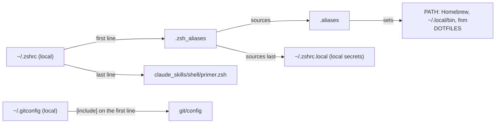

# dotfiles

**Summary.** This repo holds the shell, editor, terminal, git and Claude Code config for a
new Mac, and `bootstrap.sh` configures a new Mac from this repo in one command. The config
is spread over three repos. The work config sits in a private repo because this repo is
public, and the bead rules sit in `beadwork` beside the board that reads them:

| Repo | Visibility | What it installs |
|---|---|---|
| `dotfiles` (this repo) | public | Shell, Neovim, tmux, git, Ghostty and cmux config. Claude Code's writing rules, key bindings and status line. The `Brewfile` of general tools |
| `beadwork` | public | Claude Code's bead rules and the `bd-tui` board |
| `claude_skills`, a directory of the private work repo | private | Claude Code's skills, commands, `CLAUDE.md` and `settings.json`. The work shell setup and the work `Brewfile` |

`bootstrap.sh` runs every step in order. A second run upgrades no installed tool, because
`brew bundle install --no-upgrade` leaves each tool at its version, and a second run of
`install.sh` prints nothing. `bootstrap.sh --check` changes nothing and lists each link,
hook or package that is missing. A hook is the line at the top of `~/.zshrc` or
`~/.bashrc`, or the `[include]` at the top of `~/.gitconfig`, that loads this repo's config.

## Set up a new Mac

**Before you begin.**
- Add an SSH key to GitHub ([GitHub's guide](https://docs.github.com/en/authentication/connecting-to-github-with-ssh)), so that you can clone this repo and the private work repo over SSH.
- Run `xcode-select --install`, which installs git.

1. From any directory, clone this repo:
   `git clone git@github.com:bdhammel/dotfiles.git ~/dotfiles`
2. On a work machine, clone the private work repo to `~/dev/primer/benhammel`, so that
   `claude_skills` sits at `~/dev/primer/benhammel/claude_skills`. If `claude_skills`
   sits at another path, set `CLAUDE_SKILLS` to that path in the shell that runs
   `bootstrap.sh` in steps 3 and 5.
3. From any directory, run `~/dotfiles/bootstrap.sh`. The script runs these steps in order:
   - Installs Homebrew and the `Brewfile`.
   - Runs `install.sh` and installs the tmux plugins.
   - Clones and installs `beadwork`, and runs the installer in `claude_skills`.
   - Restores the Neovim plugins to the versions in `nvim/lazy-lock.json`.
4. From any directory, set your git identity, which stays out of this repo:
   `git config --global user.name <name> && git config --global user.email <email>`
5. Open a new terminal and run `~/dotfiles/bootstrap.sh --check`. A finished machine
   prints `install.sh --check: every link and hook is in place` and
   `The Brewfile's dependencies are satisfied.`
6. Map Caps Lock to Escape in System Settings > Keyboard > Keyboard Shortcuts >
   Modifier Keys.

## The three scripts differ in what they are allowed to change

| Script | What it changes | Network and sudo |
|---|---|---|
| `bootstrap.sh` | Installs Homebrew and packages with `brew bundle install --no-upgrade`, then runs the installers of all three repos | Uses the network. The Homebrew installer asks for sudo |
| `install.sh` | Links this repo's files into `$HOME`, adds one hook to `~/.zshrc`, `~/.bashrc` and `~/.gitconfig`, and clones tpm | Makes one `git clone` of tpm, and never runs brew or sudo |
| `quick_setup.sh` | Downloads `basic_vimrc` and `.tmux.conf`, and adds vi mode and aliases to `~/.bashrc`, on a machine you do not own | Uses the network, and never overwrites an existing file |

When a real file sits where `install.sh` puts a link, `install.sh` moves the file to
`<name>.bak.<timestamp>`, so that no backup overwrites another.

## The shell and git config are hooked in, not replaced

`~/.zshrc` and `~/.gitconfig` stay local files, because tool installers append to them and
the identity in `~/.gitconfig` must stay out of a public repo. Each local file holds only
its hooks and machine-only settings, and every shared setting lives in a repo.



*The two local files hold one hook each per repo, and `.aliases` sets `PATH` and
`DOTFILES` for every shell.*

- **Shell.** `install.sh` adds `[ -f ~/.zsh_aliases ] && source ~/.zsh_aliases` as the
  first line of `~/.zshrc`. `.zsh_aliases` sources `.aliases` through the `~/.aliases`
  link, and `.aliases` puts Homebrew, `~/.local/bin` and fnm's Node on `PATH` and sets
  `DOTFILES` to this repo's location. Put machine-only lines below the hook. Put secrets
  in `~/.zshrc.local`, which `.zsh_aliases` sources last, so that the secrets stay out of
  every repo. A bash machine gets the same hook for `~/.bash_aliases` in `~/.bashrc`.
- **Git.** `install.sh` adds an `[include]` of `git/config` as the first lines of
  `~/.gitconfig`. Any key set later in `~/.gitconfig` overrides the value from
  `git/config`, and `install.sh --check` lists each key that does so.

## Set up a Linux machine without sudo

**Before you begin.** Clone this repo to `~/dotfiles` and run `~/dotfiles/bootstrap.sh`.
On Linux, `bootstrap.sh` skips Homebrew and runs the three installers.

1. Run `uname -m` to pick the archive: `x86_64` needs `linux_amd64`, and `aarch64` needs
   `linux_arm64`.
2. From `~/.local/bin`, which `.aliases` adds to `PATH`, download, unpack and move each
   tool in this repo's `Brewfile`:

   ```bash
   cd ~/.local/bin
   wget <url of the release archive>
   tar -zxvf <archive>
   mv <unpacked dir>/<tool> <tool>
   ```

The tools to fetch first are
[ripgrep](https://github.com/BurntSushi/ripgrep/releases),
[tmux](https://github.com/nelsonenzo/tmux-appimage/releases/latest),
[nvim](https://github.com/neovim/neovim-releases/releases),
[fzf](https://github.com/junegunn/fzf/releases/), fd,
[yank](https://github.com/mptre/yank/releases) and bat.

To map Caps Lock to Escape on Ubuntu, run this from any directory:
`dconf write /org/gnome/desktop/input-sources/xkb-options "['caps:escape']"`.

## Set up a machine you do not own

From any directory, run:

```bash
curl -fsSL https://raw.githubusercontent.com/bdhammel/dotfiles/master/quick_setup.sh | bash
```

To fetch only the basic vimrc, run this from any directory:
`curl -fsSL https://raw.githubusercontent.com/bdhammel/dotfiles/master/basic_vimrc -o ~/.vimrc`.

## tmux clipboard, git maintenance and Vim buffer commands

tmux copies to the system clipboard over OSC 52, as the
[tmux clipboard guide](https://github.com/tmux/tmux/wiki/Clipboard#quick-summary)
describes.

In a large repo, `git maintenance start` schedules background prefetch and garbage
collection.

| Vim buffer and split task | Command |
|---|---|
| Next or previous buffer | `:bn`, `:bp` |
| List buffers | `:ls` |
| Open a file in a new buffer | `:e <file>` |
| Delete the current buffer | `:bd` |
| Horizontal or vertical split | `:sp <file>`, `:vs <file>` |
